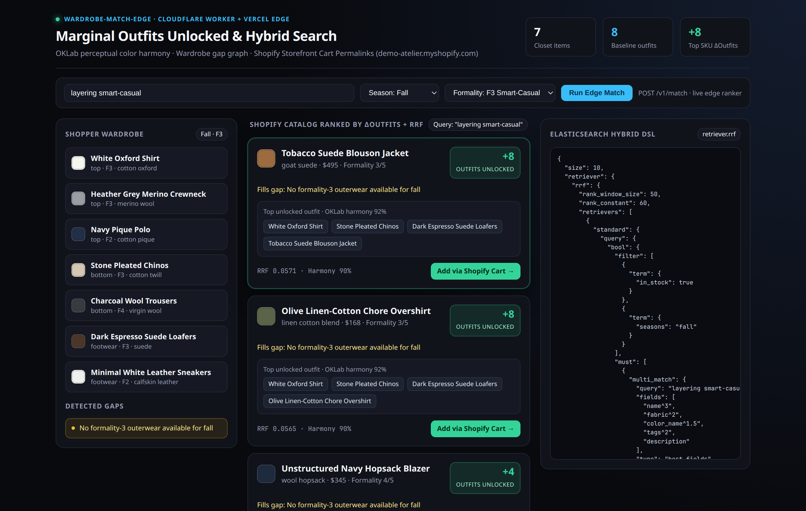
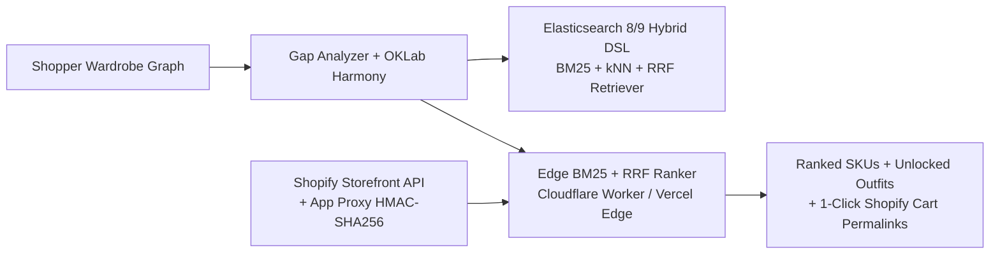

# wardrobe-match-edge

An edge-native **outfit-compatibility graph and hybrid catalog search engine** that bridges a shopper's digital wardrobe to **Shopify** storefronts and **Elasticsearch** indices — running on **Cloudflare Workers** or **Vercel Edge Functions** with zero runtime dependencies.



## The core idea: Marginal Outfits Unlocked

Traditional retail recommendation engines only see what a shopper clicked inside one store. When paired with a digital wardrobe, a merchant can rank every product $P$ by **Marginal Outfits Unlocked** ($\Delta\text{Outfits}(P \mid W)$) — the exact number of net-new, color-harmonious, season- and formality-consistent outfits that buying $P$ unlocks with items the shopper *already owns*.



## Key engineering components

- **Perceptual OKLab / OKLCH Color Harmony (`src/core/oklab.ts`)** — converts hex garment colors through Linear RGB → LMS → OKLab/OKLCH to score neutral anchoring, tonal monochrome, analogous, and complementary pairings deterministically without LLM latency.
- **Wardrobe Gap & $\Delta\text{Outfits}$ Graph (`src/core/compatibility.ts`)** — detects missing structural slots (e.g., fall smart-casual outerwear) and computes exact marginal outfit utility for every candidate SKU.
- **Elasticsearch Hybrid RRF Compiler (`src/adapters/elasticsearch.ts`) + Edge BM25/RRF (`src/core/hybrid-search.ts`)** — compiles wardrobe gap profiles into native Elasticsearch `retriever.rrf` queries (BM25 `multi_match` + `knn` + structured filters) and executes exact Okapi BM25 + Reciprocal Rank Fusion locally at the edge when no cluster credentials are bound.
- **Shopify Storefront & App Proxy Adapter (`src/adapters/shopify.ts`)** — normalizes Shopify Storefront GraphQL product nodes, verifies Shopify App Proxy requests via constant-time **Web Crypto HMAC-SHA256**, and builds 1-click Shopify Cart Permalinks carrying attribution attributes.
- **Dual Edge Runtime (`src/worker.ts` + `wrangler.toml` + `api/edge.ts`)** — pure Web Standards Fetch handler with zero runtime npm dependencies.

## API endpoints

| Route | Description |
| --- | --- |
| `GET /` | Interactive Edge Playground UI (when `Accept: text/html` or `?view=ui`) or live JSON demo output |
| `POST /v1/gaps` | Analyze a wardrobe JSON array and return slot counts + missing gaps |
| `POST /v1/match` | Hybrid BM25 + vector + $\Delta\text{Outfits}$ ranking + Shopify cart URLs + compiled Elasticsearch DSL |
| `POST /v1/elasticsearch/query` | Emit production Elasticsearch `retriever.rrf` JSON for any wardrobe profile |
| `GET /v1/shopify/proxy` | Shopify App Proxy endpoint with Web Crypto HMAC-SHA256 signature verification |

## Local checks & deployment

```bash
npm install
npm run typecheck
npm test
```

Deploy to **Cloudflare Workers**:

```bash
npx wrangler deploy
```

Or deploy directly to **Vercel Edge** using `api/edge.ts`.

## License

MIT
